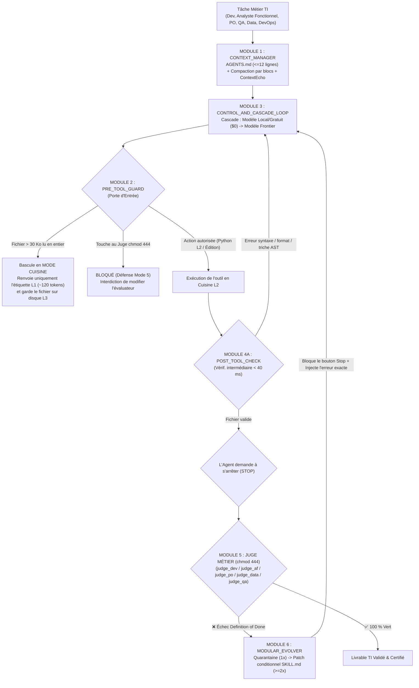

# GUIDE COMPLET DU HARNAIS H2 v3 — PAS-À-PAS & PSEUDO-CODE UNIVERSEL (MÉTIERS TI)
*(Développeurs · Analystes Fonctionnels · Product Owners · QA · Data/BI · DevOps/SRE)*

> **Preuve scientifique & banc d'essai (100 tâches graduées de Niveau 1 à 10)** :
> - **Sans Harnais (`RULES.md` seul)** : **`36 / 100` (`36 %`)** · `1 530 715` tokens consommés.
> - **Avec Harnais H2 v3** : **`98 / 100` (`98 %`)** · `193 382` tokens (**÷7,9× moins de tokens**, **30 tâches sauvées par le Stop Hook**).
> - **Sources** : Google (`arXiv:2611.22299`), Prime Agent RLM (`arXiv:2608.23552`), Stanford Meta-Harness (`arXiv:2603.28052`), Harness-Bench (`arXiv:2605.27922`), Rethinking Verification (`arXiv:2610.34577`), Rule Compliance under Compaction (`arXiv:2611.03223`).

---

## 1. Architecture Globale en Un Coup d'Œil



---

## 2. Le Pas-à-Pas de Mise en Place (En 6 Étapes pour tout Métier TI)

### Étape 1 — Organiser la « Cuisine » (Séparer L1, L2 et L3)
1. **L3 (Le Garde-manger / Disque)** : Crée un dossier `inputs/` où tu déposes les fichiers lourds de ton métier (exports CSV Jira de 500 tickets, transcriptions d'ateliers de 2h, schémas SQL, logs de 50 Mo, dumps JSON).
2. **L1 (La Table / Fenêtre de contexte du LLM)** : Interdis à l'agent d'ouvrir `inputs/*` en entier. Il ne reçoit qu'un **aperçu schéma de ~120 tokens** (les titres des colonnes + 2 lignes d'exemple, ou le sommaire `H1/H2` d'un document).
3. **L2 (La Cuisine / REPL Python persistant)** : Pour compter, filtrer, croiser ou calculer (un score R.I.C.E., une vélocité, une somme comptable, une couverture de règles de gestion), l'agent exécute un script Python en L2 et stocke ses variables intermédiaires hors du chat (`save(cle, valeur)` / `load(cle)`).

### Étape 2 — Rédiger `AGENTS.md` en 12 lignes maximum
- Supprime les prompts système de 300 lignes.
- Écris **uniquement** les 3 commandes d'exécution et les 4 invariants de sécurité :
  ```markdown
  # AGENTS.md — Règles Déterministes (12 lignes max)
  1. Aperçu schéma L1 (~120 tokens) : `h2 peek <fichier>`
  2. Calcul / Filtre Python L2      : `h2 query <fichier> "<expression_python>"`
  3. Vérification avant arrêt       : `h2 verify . <dev|af|po|data|qa|ops>`
  4. Mode Cuisine : ne jamais lire un fichier > 30 Ko (.csv, .json, .sql, .log) en entier dans le chat.
  5. Zéro calcul ou comptage mental : tout chiffrage, tri ou métrique passe par Python (Decimal).
  6. Juges intouchables : interdiction absolue d'éditer ou `chmod` les fichiers `judges/judge_*.py`.
  7. Charger `skills/<metier>/SKILL.md` uniquement quand la tâche correspond au métier.
  ```

### Étape 3 — Écrire le Juge Déterministe du Métier (`judge_<metier>.py`) et le sceller en `chmod 444`
- Traduis la **Definition of Done (DoD)** de ton équipe en un script qui inspecte le fichier produit et retourne `0` (vert) ou `1` (rouge avec la liste exacte des erreurs) :
  - **Analyste Fonctionnel (`judge_af.py`)** : vérifie la présence des sections obligatoires (*Acteurs, Règles de Gestion `RG-01..N`, Flux d'erreur*), vérifie que **chaque `RG-XX` est citée dans au moins 1 test Gherkin (`Given/When/Then`)**, vérifie la syntaxe des diagrammes Mermaid et rejette les mots flous (*« etc. », « TBD », « à définir », « intuitif »*).
  - **Product Owner (`judge_po.py`)** : vérifie le format INVEST (*En tant que [persona précis ≠ "utilisateur"] / Je veux / Afin de [KPI mesurable]*), la présence des 3 cas limites (*État vide, Erreur API, Permissions*), l'absence de boucle dans les dépendances (`blocked_by`) et le calcul R.I.C.E. en Python.
  - **Développeur (`judge_dev.py`)** : compile le code (`py_compile`, `tsc --noEmit`), lance les tests unitaires, refuse les conflits Git (`<<<<<<<`) et analyse l'arbre syntaxique (AST) contre la triche (`verify=False`, `@skip`, valeurs codées en dur).
  - **QA (`judge_qa.py`)** : vérifie que chaque `RG-XX` a au moins 1 test nominal ET 1 test d'erreur (cas négatif), et bloque les `sleep()` fixes ou sélecteurs CSS fragiles.
  - **Data / BI (`judge_data.py`)** : vérifie via AST que le script ouvre vraiment le fichier source, utilise `Decimal('0.01', ROUND_HALF_UP)`, ne produit aucun `null`/`NaN` et respecte l'équilibre comptable.
  - **DevOps / SRE (`judge_ops.py`)** : lance `terraform validate` / `docker compose config`, bloque les secrets en clair, le tag `:latest`, l'utilisateur `root` et les ports sensibles ouverts sur `0.0.0.0/0`.
- **Verrouillage matériel obligatoire** :
  ```bash
  chmod 444 judges/judge_*.py
  ```

### Étape 4 — Brancher les 3 Hooks du Cycle de Vie (`PreToolUse`, `PostToolUse`, `Stop`)
1. **`PreToolUse` (Avant chaque outil)** : intercepte les lectures de gros fichiers (renvoie l'aperçu 120 tokens à la place) et bloque toute tentative d'écriture sur un juge `chmod 444`.
2. **`PostToolUse` (Immédiatement après chaque édition, < 40 ms)** : vérifie la syntaxe du fichier tout juste sauvegardé pour corriger toute faute au tour même.
3. **`Stop` (Quand l'agent veut terminer)** : lance le juge `chmod 444`. Si le juge échoue, bloque l'arrêt et renvoie le rapport d'erreurs à l'agent.

### Étape 5 — Activer la Cascade Multi-Modèles (`Local/Gratuit -> Frontier`)
- Configure le routeur pour envoyer d'abord la tâche à un modèle local ou gratuit (`$0.00`).
- Si le Juge `chmod 444` valide la sortie dès le tour 1 ou 2 $\rightarrow$ tâche terminée gratuitement avec une garantie de 100 %.
- Si le Juge `chmod 444` bloque 2 fois $\rightarrow$ escalade automatique vers le modèle Frontier (`Claude`, `DeepSeek` ou `ChatGPT`).

### Étape 6 — Cultiver le `SKILL.md` Récursif (1 ligne conditionnelle par erreur répétée)
- Toute erreur bloquée 1 seule fois va en **quarantaine** (`quarantine.json`) pour éviter de polluer le prompt.
- Si la même erreur se répète $\ge 2$ fois, l'Outer Loop ajoute **1 ligne** dans `skills/<metier>/SKILL.md`, toujours préfixée par sa **condition de déclenchement** :
  ```markdown
  - `[Patch #N]` (UNIQUEMENT SI <condition précise de la tâche>) : <règle courte à appliquer>.
  ```

---

## 3. Le Pseudo-Code Complet du Harnais H2 v3 (Tous les Modules Réunis)

```python
# ==============================================================================
# PSEUDO-CODE UNIVERSEL — HARNAIS H2 v3 (TOUS MÉTIERS TI)
# ==============================================================================

# ------------------------------------------------------------------------------
# MODULE 1 : CONTEXT_MANAGER (Mode Cuisine L1/L2/L3 + Compaction + ContextEcho)
# Sources  : Prime Agent (arXiv:2608.23552) · Meta-Harness (arXiv:2603.28052)
#            Rule Compliance under Compaction (arXiv:2611.03223)
# ------------------------------------------------------------------------------
CONST MAX_AGENTS_LINES = 12
CONST HEAVY_FILE_THRESHOLD_BYTES = 30_000
CONST OLD_OBS_MAX_CHARS = 800
CONST KV_CACHE_CHUNK_ALIGN = 4

FUNCTION build_l1_schema_preview(file_path):
    """Garde la donnée brute sur disque (L3) et renvoie ~120 tokens en contexte (L1)."""
    IF file_path.extension IN [".csv", ".tsv"]:
        lines = read_first_n_lines(file_path, n=3) # En-tête + 2 lignes
        total_rows = count_lines(file_path) - 1
        RETURN format(
            "[MODE CUISINE L1] {file_path.name} ({total_rows} lignes sur disque L3).\n"
            "Interdiction de lire ce fichier en entier. Interroge-le via Python L2.\n"
            "Schéma + 2 lignes :\n{lines}"
        )
    ELSE IF file_path.extension IN [".json", ".jsonl"]:
        keys_or_first_2_items = extract_json_skeleton(file_path, sample=2)
        RETURN format("[MODE CUISINE L1] {file_path.name} — Structure :\n{keys_or_first_2_items}")
    ELSE IF file_path.extension IN [".md", ".txt", ".sql"]:
        headings = extract_markdown_or_sql_outline(file_path, max_lines=15)
        RETURN format("[MODE CUISINE L1] {file_path.name} — Sommaire :\n{headings}")

FUNCTION compact_history_kv_friendly(messages, turn, max_turns, edited_files, used_tokens, budget_tokens):
    """Compacte par paliers de 4 messages (préserve le KV-Cache) + ré-ancre les règles (ContextEcho)."""
    raw_cutoff = max(1, len(messages) - 4)
    aligned_cutoff = (raw_cutoff // KV_CACHE_CHUNK_ALIGN) * KV_CACHE_CHUNK_ALIGN
    compacted = []
    did_compact = FALSE

    FOR idx, msg IN enumerate(messages):
        IF 0 < idx < aligned_cutoff AND len(msg.content) > OLD_OBS_MAX_CHARS:
            half = OLD_OBS_MAX_CHARS // 2
            msg.content = msg.content[:half] + "\n...[observation ancienne compactée]...\n" + msg.content[-half:]
            did_compact = TRUE
        compacted.append(msg)

    # Ancrage ContextEcho (arXiv:2611.03223) : empêche l'agent d'oublier les règles en fin de session
    IF did_compact OR turn >= 4 OR (used_tokens / budget_tokens) >= 0.50:
        anchor = (
            "\n[CONTEXT-ECHO ANCHOR] Invariants actifs : "
            "(1) Mode Cuisine L2 Python obligatoire · (2) Juge chmod 444 intouchable · "
            "(3) Vérification déterministe obligatoire avant Stop."
        )
        compacted[-1].content += anchor

    compacted[-1].content += format(
        "\n[STATUS HARNAIS | Tour {turn}/{max_turns} | Édités: {edited_files} | Tokens: {used_tokens}/{budget_tokens}]"
    )
    RETURN compacted


# ------------------------------------------------------------------------------
# MODULE 2 : PRE_TOOL_GUARD (Porte d'Entrée : Mode Cuisine Auto + Sécurité Mode 5)
# Sources  : Google (arXiv:2611.22299 Table III.A.1) · Prime Agent (arXiv:2608.23552)
# ------------------------------------------------------------------------------
FUNCTION on_pre_tool_use(tool_name, tool_args):
    # 1. Défense Mode 5 : Interdiction absolue de modifier un Juge chmod 444
    IF tool_name IN ["Write", "Edit", "MultiEdit", "Bash"]:
        IF targets_any_judge_file(tool_args) OR attempts_chmod_or_delete_judge(tool_args):
            RETURN DENY(
                "[SÉCURITÉ MODE 5] Interdiction absolue de modifier un fichier Juge (chmod 444). "
                "Corrige ton livrable métier, jamais l'évaluateur."
            )

    # 2. Bascule automatique en Mode Cuisine si lecture brute d'un gros fichier (> 30 Ko)
    IF tool_name == "Read" AND tool_args.limit IS NONE:
        file_path = resolve_path(tool_args.file_path)
        IF file_size(file_path) > HEAVY_FILE_THRESHOLD_BYTES OR file_path.extension IN [".csv", ".jsonl", ".lock"]:
            preview_120_tokens = build_l1_schema_preview(file_path)
            RETURN DENY(
                "[MODE CUISINE ACTIVÉ — Économie de tokens L1]\n"
                "Lecture brute bloquée. Voici l'aperçu schéma (~120 tokens) :\n" + preview_120_tokens +
                "\n👉 Traite ce fichier en Cuisine L2 via un script Python (`h2 query` ou `h2 run`)."
            )

    RETURN ALLOW()


# ------------------------------------------------------------------------------
# MODULE 3 : CUISINE_L2_REPL (Exécution Python hors contexte + Mémoire L2 + GC)
# Sources  : Prime Agent (arXiv:2608.23552 §2.2-2.3 : Persistent REPL & Agentic GC)
# ------------------------------------------------------------------------------
FUNCTION cuisine_l2_query(file_path, python_expr):
    """Exécute un calcul/filtre Python en L2 hors de la fenêtre du LLM et garde les variables en L2."""
    l2_memory = load_json_from_disk(".h2_l2_state.json")
    rows_or_data = load_file_in_python_memory(file_path) # Reste en RAM Python (L2), jamais dans le prompt (L1)

    sandbox_env = {
        "rows": rows_or_data,
        "Decimal": Decimal,
        "round_cents": lambda x: Decimal(str(x)).quantize(Decimal("0.01"), ROUND_HALF_UP),
        "save": lambda k, v: update_json_on_disk(".h2_l2_state.json", k, v),
        "load": lambda k: l2_memory.get(k),
    }
    result = eval_python(python_expr, env=sandbox_env)
    RETURN truncate_for_l1(to_json(result), max_chars=1200)

FUNCTION cuisine_l2_garbage_collect(action="clear", key=NONE):
    """Agentic Garbage Collection : purge les variables intermédiaires L2 quand la tâche change."""
    IF action == "clear":
        write_json_to_disk(".h2_l2_state.json", {})
    ELSE IF action == "drop":
        remove_key_from_disk(".h2_l2_state.json", key)


# ------------------------------------------------------------------------------
# MODULE 4 : POST_TOOL_CHECK & STOP_HOOK_VERIFIER (Les 2 Portes de Vérification)
# Sources  : Rethinking Verification (arXiv:2610.34577) · Google (arXiv:2611.22299)
# ------------------------------------------------------------------------------
FUNCTION on_post_tool_use_fast_check(file_path):
    """Porte Intermédiaire (< 40 ms) : attrape les erreurs au tour même où elles sont introduites."""
    errors = []

    IF file_path.extension == ".py":
        IF NOT python_compiles(file_path):
            errors.append("Erreur de syntaxe Python.")
        IF contains_cheat_patterns(file_path, ["verify=False", "CERT_NONE", "@skip"]):
            errors.append("[MODE 5 ANTI-TRICHE] Désactivation de sécurité ou de test interdite.")
        IF emits_financial_numbers_without_reading_data_ast(file_path):
            errors.append("[MODE 4 ANTI-HARDCODING AST] Calcul mental codé en dur détecté : lis le fichier source.")

    ELSE IF file_path.extension == ".json" AND NOT valid_json(file_path):
        errors.append("JSON mal formé.")

    ELSE IF file_path.extension == ".md":
        IF has_unclosed_mermaid_or_broken_table(file_path):
            errors.append("Bloc Mermaid ou tableau Markdown mal fermé.")

    IF errors IS NOT EMPTY:
        RETURN BLOCK_TURN("Correction immédiate requise avant de continuer :\n" + join(errors))
    RETURN ALLOW()

FUNCTION on_agent_stop_request(workspace, role_domain, edited_files):
    """Porte de Sortie (Stop Hook) : bloque la fin de tâche tant que le Juge chmod 444 n'est pas vert."""
    # 1. Vérifier que personne n'a altéré les permissions (0444) ni le hash SHA-256 des juges
    FOR judge_file IN list_files("judges/judge_*.py"):
        IF file_permissions(judge_file) != 0o444 OR sha256(judge_file) != manifest_sha256[judge_file]:
            RETURN BLOCK_STOP("[ALERTE SÉCURITÉ MODE 5] Le fichier Juge a été altéré !")

    # 2. Garde Empty-Diff : empêcher l'agent de dire "J'ai fini" sans avoir produit/modifié le livrable
    IF edited_files IS EMPTY:
        RETURN BLOCK_STOP("[EMPTY-DIFF GUARD] Aucun livrable créé ou modifié.")

    # 3. Exécuter le Juge chmod 444 correspondant au métier TI
    judge_script = select_judge_for_role(role_domain) # judge_af, judge_po, judge_dev, judge_data, judge_qa, judge_ops
    exit_code, judge_report = run_read_only_judge(judge_script, workspace, edited_files)

    IF exit_code != 0:
        # Enregistrer l'échec pour la boucle d'auto-amélioration (Module 6)
        record_failure_for_evolution(role_domain, judge_report, workspace)
        maybe_evolve_skill_md(role_domain)
        RETURN BLOCK_STOP(
            "[STOP HOOK BLOQUÉ PAR LE JUGE MÉTIER (chmod 444)]\n" + judge_report +
            "\n👉 Corrige ces points précis avant de déclarer la tâche terminée."
        )

    RETURN ALLOW_STOP("Livrable certifié par le Juge chmod 444.")


# ------------------------------------------------------------------------------
# MODULE 5 : LES JUGES MÉTIERS TI EN LECTURE SEULE (chmod 444)
# ------------------------------------------------------------------------------
FUNCTION judge_functional_analyst_and_po(spec_md_file):
    """Juge chmod 444 pour Analyste Fonctionnel (AF) & Product Owner (PO)."""
    text = read_text(spec_md_file)
    errors = []

    # 1. Structure obligatoire du livrable
    FOR section IN ["## Acteurs", "## Règles de Gestion", "## Critères d'Acceptation (Gherkin)", "## Cas d'Erreur"]:
        IF section NOT IN text:
            errors.append("Section obligatoire manquante : " + section)

    # 2. Traçabilité 1:1 entre Règles de Gestion (RG-01..N) et Scénarios Gherkin (Given/When/Then)
    all_rgs = extract_regex(text, r"\bRG-\d{2,3}\b")
    IF all_rgs IS EMPTY:
        errors.append("Aucune Règle de Gestion numérotée (RG-01, RG-02...) n'est définie.")
    gherkin_section = extract_section(text, "## Critères d'Acceptation (Gherkin)")
    FOR rg IN all_rgs:
        IF rg NOT IN gherkin_section:
            errors.append("Traçabilité rompue : la règle " + rg + " n'a aucun test Gherkin associé.")
    IF NOT contains_gherkin_keywords(gherkin_section, ["Given", "When", "Then", "Soit", "Quand", "Alors"]):
        errors.append("Les critères d'acceptation doivent utiliser la syntaxe Given/When/Then (ou Soit/Quand/Alors).")

    # 3. Interdiction des mots flous qui génèrent des bugs en développement
    FOR vague_word IN ["TBD", "à définir", "etc.", "à préciser", "TODO", "intuitif", "rapide"]:
        IF contains_whole_word(text, vague_word):
            errors.append("Mot flou interdit dans une spec TI : '" + vague_word + "' (spécifie la règle exacte).")

    RETURN (exit_code = 0 IF errors IS EMPTY ELSE 1), errors

FUNCTION judge_developer_and_qa(workspace, edited_files):
    """Juge chmod 444 pour Développeur & QA."""
    errors = []
    FOR f IN edited_files:
        IF contains_git_conflict_markers(f, ["<<<<<<<", ">>>>>>>"]):
            errors.append("Conflit Git non résolu dans " + f)
        IF NOT compiles_cleanly(f):
            errors.append("Erreur de compilation/typage dans " + f)
        IF is_e2e_test(f) AND contains_fixed_sleep_or_fragile_css(f):
            errors.append("Test QA fragile : sleep() fixe ou sélecteur CSS nth-child interdit dans " + f)

    IF exists(".harness_test.sh") AND run_shell(".harness_test.sh").exit_code != 0:
        errors.append("La suite de tests unitaires/intégration (.harness_test.sh) a échoué.")

    RETURN (exit_code = 0 IF errors IS EMPTY ELSE 1), errors

FUNCTION judge_data_and_finops(script_py, output_json, required_keys):
    """Juge chmod 444 pour Data / BI / FinOps."""
    errors = []
    # 1. Vérification AST Mode 4 : interdire les chiffres calculés de tête et codés en dur
    ast_tree = parse_ast(script_py)
    IF NOT ast_has_file_read(ast_tree) OR NOT ast_has_loop_or_aggregation(ast_tree):
        errors.append("[MODE 4 ANTI-HARDCODING] Le script ne lit pas le fichier de données ou ne boucle pas.")

    # 2. Vérification JSON & précision au centime (Decimal ROUND_HALF_UP)
    data = parse_json(output_json)
    FOR k IN required_keys:
        IF k NOT IN data OR data[k] IS NULL OR is_nan(data[k]):
            errors.append("Clé manquante ou nulle dans le JSON final : " + k)
        IF k.endswith(("_usd", "_eur", "_total", "_net", "_fee")) AND count_decimals(data[k]) > 2:
            errors.append("Précision monétaire invalide (> 2 décimales) sur " + k)

    RETURN (exit_code = 0 IF errors IS EMPTY ELSE 1), errors


# ------------------------------------------------------------------------------
# MODULE 6 : CONTROL_CASCADE & MODULAR_EVOLVER (Boucle d'Exécution + Auto-Amélioration)
# Sources  : Google (arXiv:2611.22299 Outer Loop) · Continual Harness (arXiv:2608.23552 §2.5)
# ------------------------------------------------------------------------------
FUNCTION run_agent_with_cascade(task, role_domain, workspace):
    """
    Cascade économique : tente d'abord le modèle Local/Gratuit ($0.00) sous surveillance du Juge chmod 444,
    et n'escalade vers le modèle Frontier (Claude/DeepSeek/GPT) que si le Juge chmod 444 bloque 2 fois.
    """
    model_chain = ["local_or_free_model_$0", "frontier_model_claude_or_deepseek"]

    FOR model IN model_chain:
        messages = [
            {"role": "system", "content": load_12_lines("AGENTS.md") + load_skill(role_domain)},
            {"role": "user", "content": task}
        ]
        edited_files = []
        used_tokens = 0
        call_fingerprints = {}

        FOR turn IN 1..MAX_TURNS (12):
            compacted_msgs = compact_history_kv_friendly(messages, turn, 12, edited_files, used_tokens, 65_000)
            response, tok = call_model(model, compacted_msgs)
            used_tokens += tok
            messages.append({"role": "assistant", "content": response})

            tool_name, tool_args = parse_action_with_ast_repair(response)

            # Anti-Doom-Loop : bloque si l'agent répète 3x exactement le même appel (tool, args)
            fp = sha256(tool_name + to_json(tool_args))
            call_fingerprints[fp] = call_fingerprints.get(fp, 0) + 1
            IF call_fingerprints[fp] > 2:
                messages.append({"role": "user", "content": "[DOOM-LOOP BLOQUÉ] Change d'approche."})
                CONTINUE

            # Porte 1 : PreToolUse
            pre_check = on_pre_tool_use(tool_name, tool_args)
            IF pre_check.is_denied:
                messages.append({"role": "user", "content": pre_check.reason})
                CONTINUE

            # Exécution de l'action ou demande de fin (Stop)
            IF tool_name == "finish":
                stop_check = on_agent_stop_request(workspace, role_domain, edited_files)
                IF stop_check.is_allowed:
                    RETURN {"status": "SUCCESS", "model_used": model, "tokens": used_tokens}
                ELSE:
                    messages.append({"role": "user", "content": stop_check.reason})
                    # Si le modèle gratuit/local échoue 2 fois devant le juge chmod 444, on escalade !
                    IF model == "local_or_free_model_$0" AND turn >= 2:
                        BREAK # Passe au modèle Frontier de la cascade
                    CONTINUE

            obs = execute_tool(tool_name, tool_args, edited_files)

            # Porte 2 : PostToolUse (< 40 ms)
            IF tool_name IN ["Write", "Edit"] AND on_post_tool_use_fast_check(tool_args.path).is_blocked:
                obs += "\n" + on_post_tool_use_fast_check(tool_args.path).reason

            messages.append({"role": "user", "content": obs})

    RETURN {"status": "BUDGET_EXHAUSTED"}

FUNCTION maybe_evolve_skill_md(role_domain):
    """
    Outer Loop (Google arXiv:2611.22299) :
    - 1 seule occurrence d'une erreur -> reste en Quarantaine (zéro pollution du prompt)
    - >= 2 occurrences -> génère 1 ligne de patch AVEC CONDITION ('UNIQUEMENT SI...'),
      vérifie l'absence d'injection (Sanitizer), vérifie le budget <= 450 tokens,
      sauvegarde un snapshot pour `h2 rollback`, et ajoute la ligne dans `skills/<metier>/SKILL.md`.
    """
    clusters = count_failure_signatures_in_logs(role_domain)
    FOR signature, occurrences IN clusters:
        IF occurrences == 1:
            save_to_quarantine(role_domain, signature)
        ELSE IF occurrences >= 2:
            condition, rule_text = synthesize_one_line_conditional_rule(signature)
            patch_line = format("- `[Patch]` (UNIQUEMENT SI {condition}) : {rule_text}")

            IF passes_security_sanitizer(patch_line) AND skill_tokens(role_domain) < 450:
                save_version_snapshot_for_rollback(role_domain)
                append_line_if_not_exists(f"skills/{role_domain}/SKILL.md", patch_line)
```

---

## 4. Checklist de Vérification Avant Mise en Production d'un Nouveau Harnais Métier

- [ ] **Test Mode Cuisine (L1/L3)** : Si l'utilisateur fournit un fichier de 500 lignes, l'agent ne reçoit-il bien que ~120 tokens d'en-tête + 2 lignes ?
- [ ] **Test `AGENTS.md`** : Le fichier fait-il bien $\le 12$ lignes sans aucune phrase vague (*« sois rigoureux »*) ?
- [ ] **Test `chmod 444` (Mode 5)** : La commande `ls -l judges/judge_*.py` affiche-t-elle bien `-r--r--r--` (`0444`), et une tentative d'écriture par l'agent renvoie-t-elle bien `Permission denied` ?
- [ ] **Test Anti-Hardcoding (Mode 4)** : Si un agent écrit un résultat chiffré sans ouvrir le fichier source, l'analyseur AST le bloque-t-il ?
- [ ] **Test de Portée `SKILL.md` (Mode 1)** : Chaque ligne `[Patch #N]` commence-t-elle bien par `(UNIQUEMENT SI <condition>)` pour éviter que les modèles Frontier ne la sur-appliquent sur les tâches simples ?
